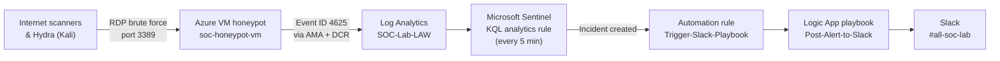
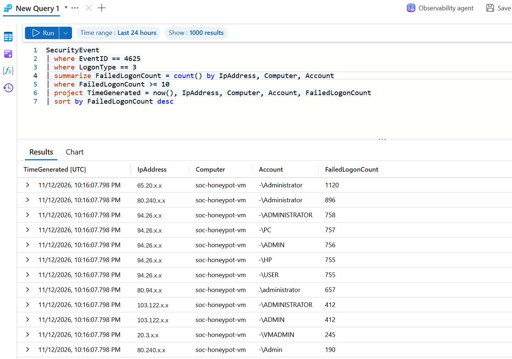

# Sentinel SOC & Automated Incident Response Lab

## Objective

This project demonstrates the end-to-end lifecycle of a Security Operations Center (SOC) workflow in a cloud environment. The objective was to design and deploy a public-facing Azure honeypot to attract live threat actors, ingest telemetry into a cloud-native SIEM (Microsoft Sentinel), engineer custom detection analytics, and orchestrate an automated incident response pipeline that pushes actionable alerts to a SOC communication channel.

## Skills & Technologies Demonstrated

* **Cloud Infrastructure:** Microsoft Azure (Virtual Machines, NSG, Log Analytics Workspace)
* **SIEM & SOAR:** Microsoft Sentinel, Microsoft Defender portal, Azure Logic Apps
* **Telemetry & Agents:** Azure Monitor Agent (AMA), Data Collection Rules (DCR), Windows Security Event Logs
* **Detection Engineering:** Kusto Query Language (KQL), MITRE ATT&CK mapping, entity mapping
* **Offensive Security:** Hydra (brute-force attack simulation)
* **Automation:** Logic Apps Slack connector, Sentinel automation rules, PowerShell

## Architecture



1. **Attacker/Scanner:** Threat actors (or simulated attacks via Hydra) target the exposed RDP port (3389) on the Windows virtual machine.
2. **Telemetry Generation:** Windows logs every failed logon attempt (Event ID 4625).
3. **Log Ingestion:** The Azure Monitor Agent (AMA) forwards these security events to the Log Analytics Workspace (`SOC-Lab-LAW`).
4. **Threat Detection:** Microsoft Sentinel evaluates the logs against a custom KQL scheduled query every 5 minutes.
5. **SOAR Automation:** When the detection threshold is breached (10+ failed logins from one IP), Sentinel creates an incident and an automation rule triggers an Azure Logic App playbook.
6. **Incident Notification:** The playbook pushes a formatted alert (title, severity, description and incident URL) to the SOC Slack channel.

## Project Phases

| Phase | Description | Write-up |
|---|---|---|
| 1 | Infrastructure & telemetry setup: honeypot VM, Log Analytics, Sentinel, AMA + DCR | [docs/01-setup.md](docs/01-setup.md) |
| 2 | Log analysis & detection engineering: KQL hunting and the scheduled analytics rule | [docs/02-log-analysis-kql.md](docs/02-log-analysis-kql.md) |
| 3 | SOAR automation: Logic App playbook, Slack integration, automation rule | [docs/03-soar-automation.md](docs/03-soar-automation.md) |
| 4 | Attack simulation & validation with Hydra | [docs/04-attack-simulation.md](docs/04-attack-simulation.md) |

### Phase 1: Infrastructure & Telemetry Configuration

* Provisioned an intentionally vulnerable Windows VM in Azure.
* Configured the Network Security Group (NSG) to allow inbound traffic from `Any` source on port 3389 (RDP) to maximise visibility of internet-wide scanners, and disabled the local Windows Firewall with PowerShell.
* Deployed a Log Analytics Workspace and Microsoft Sentinel.
* Created a Data Collection Rule (DCR) so the Azure Monitor Agent sends Windows Security Events from the VM to the workspace.

### Phase 2: Detection Engineering (KQL)

Engineered a custom KQL query to detect high-volume RDP brute-force attempts. The query filters for Event ID 4625, aggregates failures by IP address and targeted account, and flags any single IP that fails to authenticate 10 or more times. It runs as a Sentinel scheduled analytics rule every 5 minutes over the last 5 minutes of data, with IP, Host and Account entity mapping.

**MITRE ATT&CK Mapping:** Credential Access (TA0006) > Brute Force (T1110)

```kql
SecurityEvent
| where EventID == 4625
| where LogonType == 3 // Type 3 is Network logon (RDP)
| summarize FailedLogonCount = count() by IpAddress, Computer, Account
| where FailedLogonCount >= 10
| project TimeGenerated = now(), IpAddress, Computer, Account, FailedLogonCount
| sort by FailedLogonCount desc
```

All queries are in the [`kql/`](kql) folder.

**Findings:** Within the first 24 hours of exposure, the honeypot received thousands of failed RDP logons from real internet sources. The most active IP made 1,120 attempts against `Administrator`, and attackers also cycled through common account names such as `ADMIN`, `USER`, `PC`, `HP` and `VMADMIN`.



### Phase 3: SOAR Automation & Response

Rather than relying on manual dashboard monitoring, a Security Orchestration, Automation, and Response (SOAR) workflow was implemented to reduce Mean Time to Respond (MTTR).

* Created an Azure Logic App with a Sentinel incident trigger.
* Configured a Sentinel automation rule to run the playbook whenever the custom brute-force rule creates an incident.
* The Logic App uses the Slack connector to post a message containing the incident title, severity, description and a direct link to the investigation page.

### Phase 4: Attack Simulation & Validation

To validate the pipeline, an offensive simulation was run from a Kali Linux machine. The network logon cracker `Hydra` was used to send a wordlist of common passwords to the honeypot against a test account, and the ingested logs, the triggered incident and the Slack alert were all confirmed.

```bash
hydra -l hacker -P /usr/share/seclists/Passwords/Common-Credentials/best15.txt rdp://<HONEYPOT_IP> -t 1 -W 3 -V
```

A key finding came out of this phase: my own Hydra attempts reached the logs but did **not** raise a dedicated incident, because my egress rotated across several source IPs in the same subnet, so no single IP crossed the rule's `>= 10` threshold. The rule still fired reliably on the genuine single-source internet scanners. This is a real limitation of single-IP threshold aggregation (blind to distributed / rotating-source and low-and-slow attacks), discussed with tuning ideas in [docs/04-attack-simulation.md](docs/04-attack-simulation.md).

## Challenges & Lessons Learned

* **Sentinel is moving to the Defender portal.** Analytics and Automation pages in the Azure portal now redirect to Microsoft Defender, so the rule and automation were built there.
* **Playbook permissions.** The automation rule could not select the playbook at first ("No Microsoft Sentinel permissions"). Sentinel needs explicit permission on the resource group that holds the playbook (Sentinel → Settings → Playbook permissions).
* **Legacy agent deprecation.** The "Security Events via Legacy Agent" connector is deprecated, so the lab uses the Azure Monitor Agent with a Data Collection Rule.

## Future Improvements

* Automated remediation: extend the playbook to add an NSG deny rule for the attacker's IP address.
* Tune the detection to also aggregate by targeted account and by distinct-source-IP count, to catch password spraying and rotating-source brute force.
* Enable Sentinel UEBA / anomaly rules for behavioural detection that does not rely on a fixed count.
* Restrict RDP to known IPs or Just-in-Time access, and turn the Windows Firewall back on, once the data collection phase is over.

## Repository Structure

```
├── README.md
├── docs/      # step-by-step write-up for each phase
├── kql/       # KQL queries used in the lab
└── images/    # screenshots (sensitive details redacted)
```

> **Note:** Personal details, the honeypot's public IP, subscription and workspace IDs have been redacted from all screenshots. Attacker IPs are partially masked.
