# Phase 2: Log Analysis & Detection Engineering (KQL)

[← Previous: Setup](01-setup.md) | [Back to README](../README.md) | [Next: SOAR Automation →](03-soar-automation.md)

---

### Step 1: Verify the Log Flow (Data Exploration)

Before building alerts, you need to confirm that your honeypot is actually being attacked and that the logs are reaching Sentinel.

_(Note: If you just exposed the VM, it might take 15 to 45 minutes for internet scanners to find it and for logs to start appearing.)_

1. In the Azure Portal, open your `SOC-Lab-LAW` workspace (or your Microsoft Sentinel workspace).
2. In the left-hand navigation menu, click **Logs**.

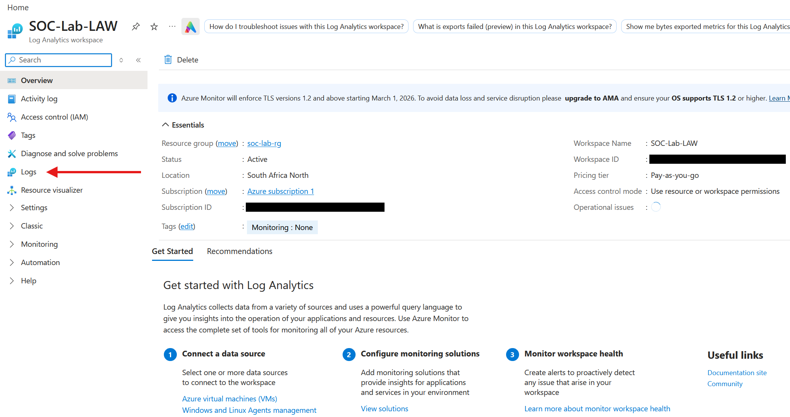

3. Close any welcome pop-ups so you have a blank query window.
4. Run this basic KQL query to check if _any_ security events are arriving ([`kql/01-verify-ingestion.kql`](../kql/01-verify-ingestion.kql)):

```kql
SecurityEvent
| take 10
```

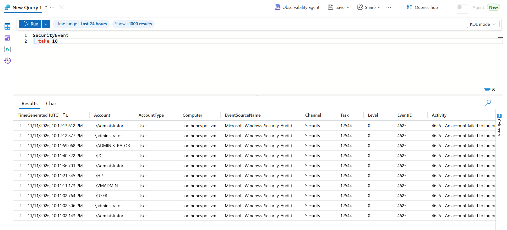

5. Now filter specifically for failed logon attempts, Event ID 4625 ([`kql/02-failed-logons-4625.kql`](../kql/02-failed-logons-4625.kql)):

```kql
SecurityEvent
| where EventID == 4625
```

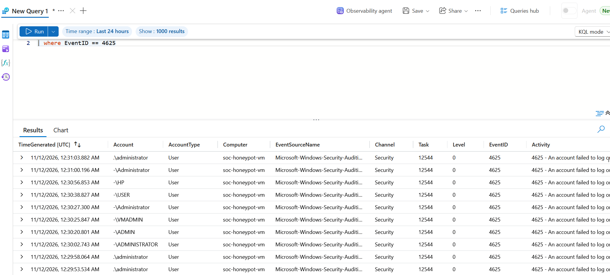

If you see a list of failed login attempts, your honeypot is officially catching flies.


### Step 2: Write the Brute-Force Detection Query

To create an incident, we need a query that looks for anomalies: in this case, a high volume of failed logins from a single IP address within a short timeframe.

Write this query into your Logs window and run it ([`kql/rdp-brute-force-detection.kql`](../kql/rdp-brute-force-detection.kql)):

```kql
SecurityEvent
| where EventID == 4625
| where LogonType == 3 // Type 3 is Network logon (RDP)
| summarize FailedLogonCount = count() by IpAddress, Computer, Account
| where FailedLogonCount >= 10
| project TimeGenerated = now(), IpAddress, Computer, Account, FailedLogonCount
| sort by FailedLogonCount desc
```

> This query counts failed logins per IP address, computer and account. If an IP fails to log in 10 or more times, it is flagged as a brute-force attempt.

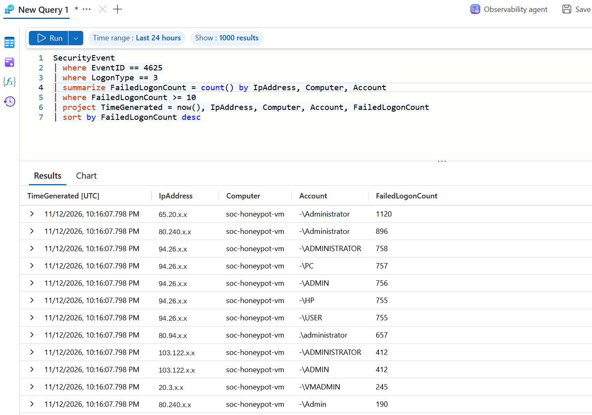

The query grouped the events by IP address, computer and account and counted them. Within 24 hours, the top source made **1,120** failed logon attempts against `Administrator`, and attackers also tried common names such as `ADMIN`, `USER`, `PC`, `HP` and `VMADMIN`. _(Attacker IPs are partially masked.)_


### Step 3: Create the Sentinel Analytics Rule

Now we turn that KQL query into an automated rule that generates SOC incidents.

1. In the left menu of Sentinel, under **Configuration**, click **Analytics**.

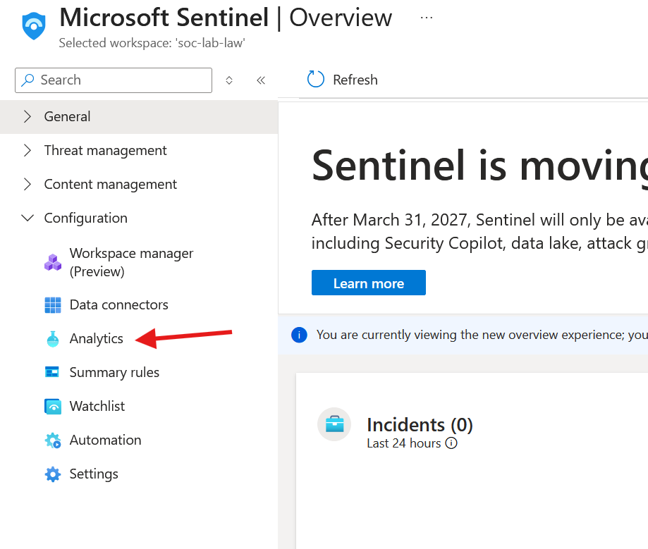

2. Analytics has moved to the Microsoft Defender portal, so click **Click here to go to the Defender portal**.

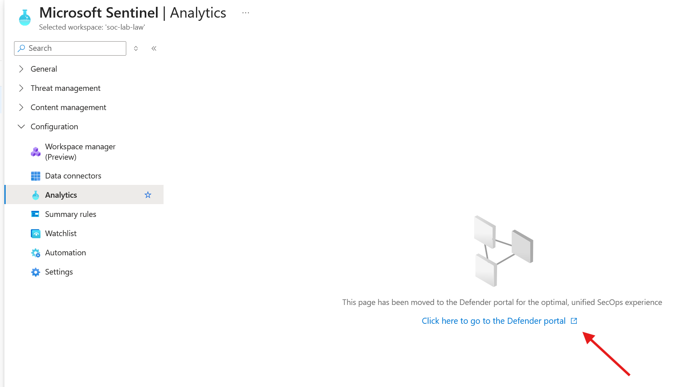

3. Click **+ Create** at the top and select **Scheduled query rule**.

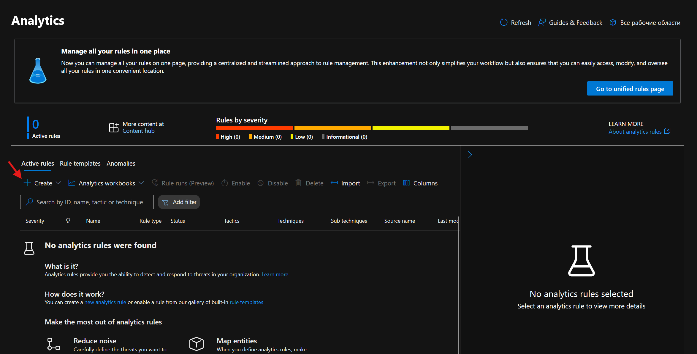

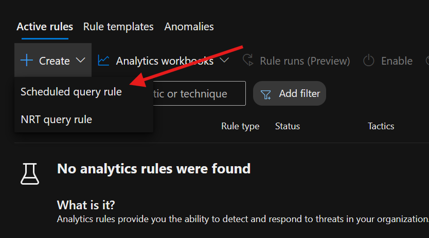

**General tab:**

- **Name:** `[RDP Brute Force Detection] High Volume Failed Logins`
- **Description:** Detects 10 or more failed RDP login attempts from a single IP address.
- **Tactics and Techniques:** Select **Credential Access** and check **T1110 - Brute Force**.
- **Severity:** High.
- Click **Next: Set rule logic**.

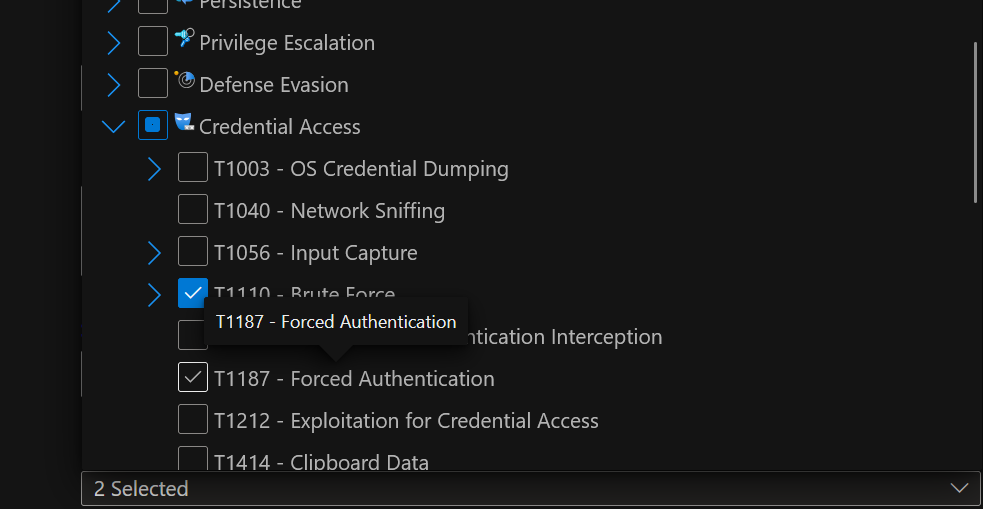

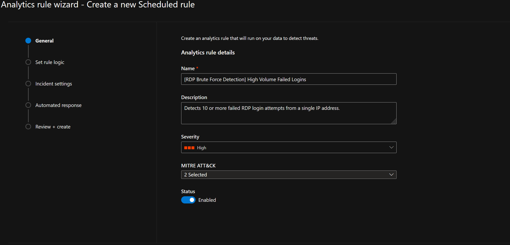

**Set rule logic tab:**

- **Rule query:** Paste the KQL query from Step 2 into the box.

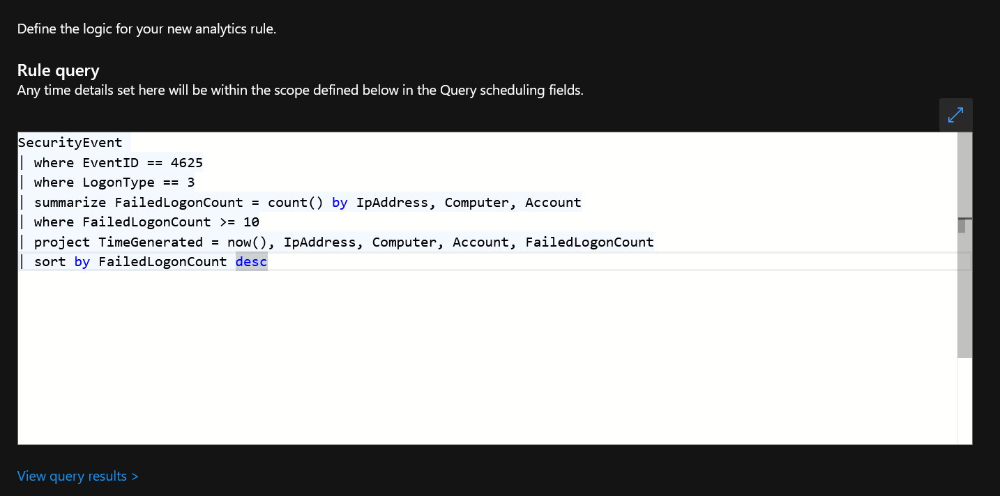

- **Entity mapping:** This lets Sentinel recognise the attacker IP, host and account in each incident, and passes them on to the playbook in Phase 3.
    - Click **Add new entity**. Entity type: **IP**, Identifier: **Address**, Value: **IpAddress**.
    - Click **Add new entity**. Entity type: **Host**, Identifier: **HostName**, Value: **Computer**.
    - Click **Add new entity**. Entity type: **Account**, Identifier: **Name**, Value: **Account**.

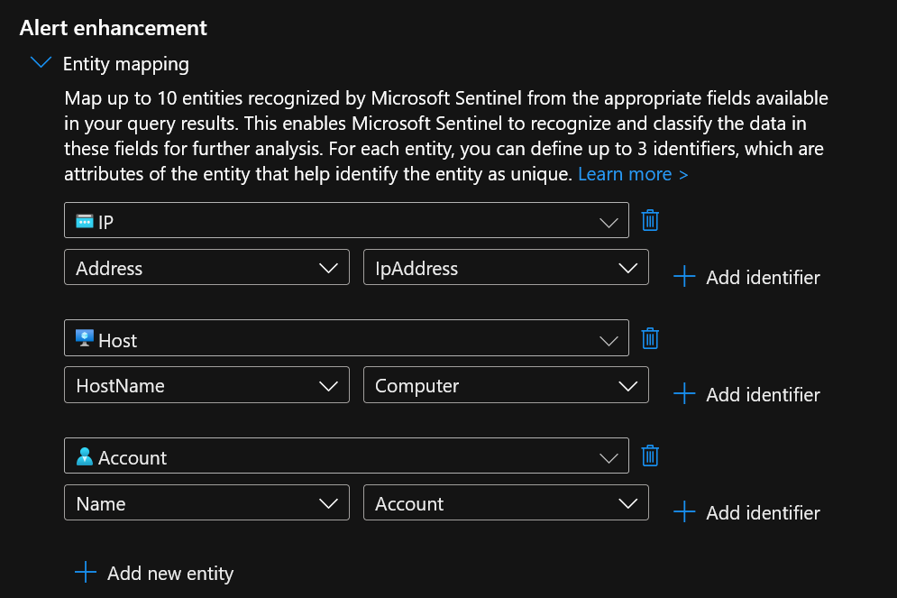

- **Query scheduling:** Set it to run every **5 minutes** and look up data from the last **5 minutes**.
- **Alert threshold:** Is greater than **0**.

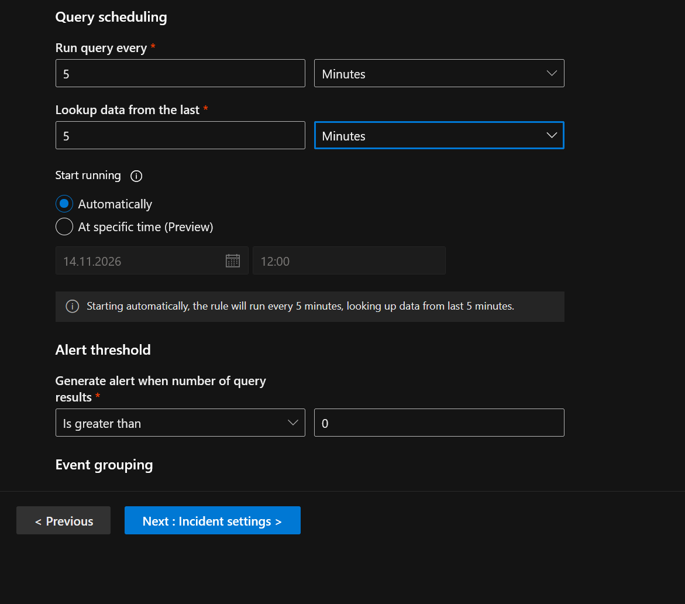

- Click **Next: Incident settings**.

**Incident settings tab:**

- Make sure **Create incidents from alerts triggered by this analytics rule** is enabled.
- Click **Next: Automated response**, then click **Next: Review + create**.

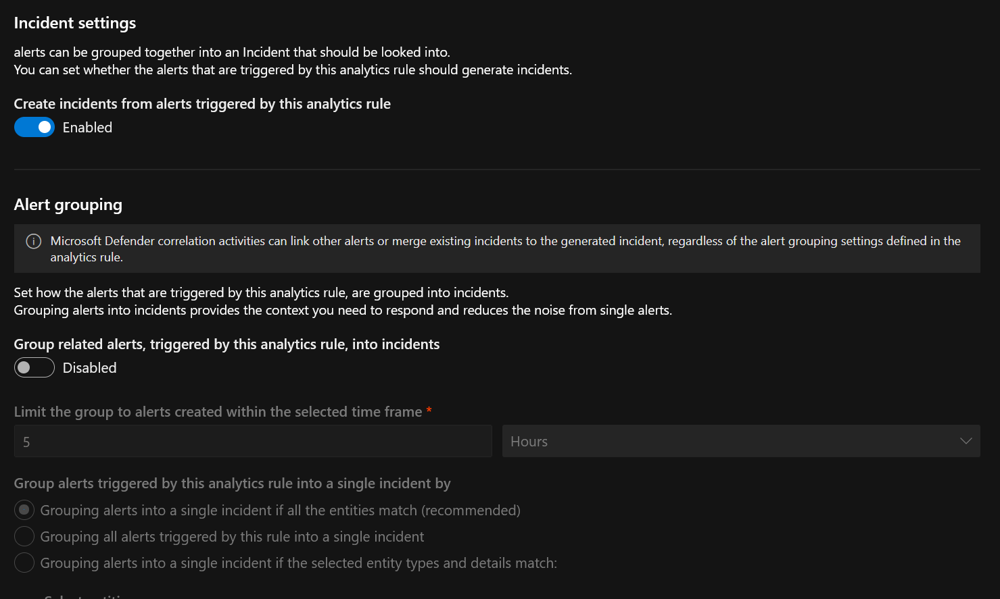

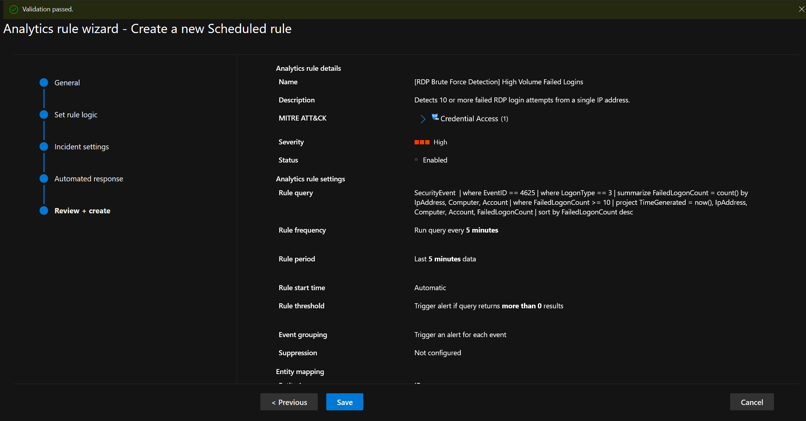

4. Click **Save**.

Your cloud SOC is now actively monitoring for brute-force attacks and will generate an incident the next time the threshold is breached.

---

[← Previous: Setup](01-setup.md) | [Back to README](../README.md) | [Next: SOAR Automation →](03-soar-automation.md)
