# Phase 3: SOAR Automation (Slack Alerts)

[← Previous: Log Analysis & KQL](02-log-analysis-kql.md) | [Back to README](../README.md) | [Next: Attack Simulation →](04-attack-simulation.md)

---

### Step 1: Prepare Your Slack Workspace

1. Open Slack (or create a free workspace). This lab uses a workspace called **Soc Lab** and the channel `#all-soc-lab`.
2. Keep Slack open in the background so you can authorise the connection in the next steps.

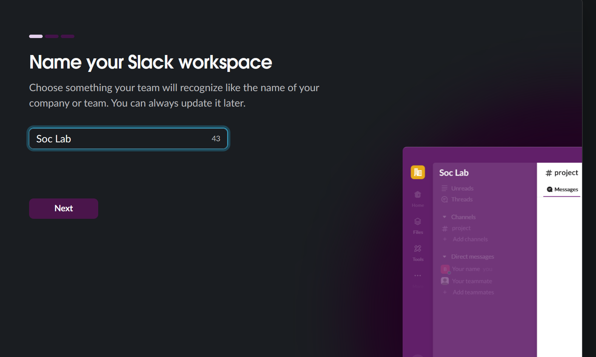

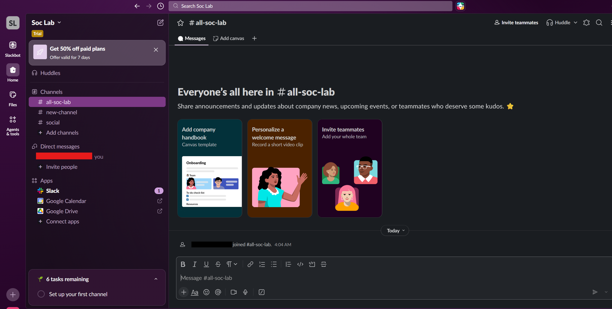


### Step 2: Create the Logic App (Sentinel Playbook)

1. In the Azure Portal search bar, type **Microsoft Sentinel** and select your `SOC-Lab-LAW` workspace.
2. In the left-hand menu, scroll down to **Configuration** and click **Automation**. It also opens in the Defender portal.

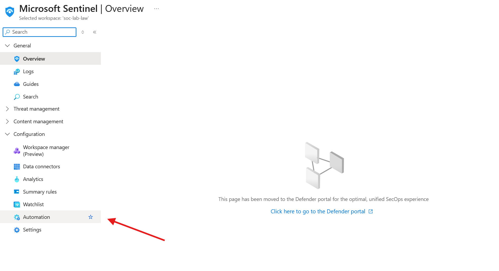

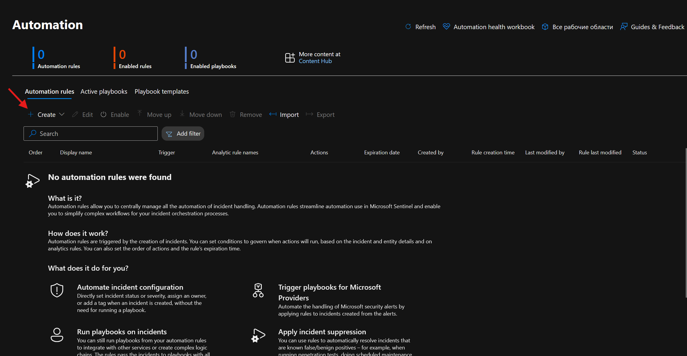

3. At the top, click **+ Create** and select **Playbook with incident trigger**.
4. **Basics tab:**
    - **Resource group:** Select your existing `SOC-Lab-RG` resource group.
    - **Playbook name:** `Post-Alert-to-Slack`
    - Click **Review + create**, then click **Create**.

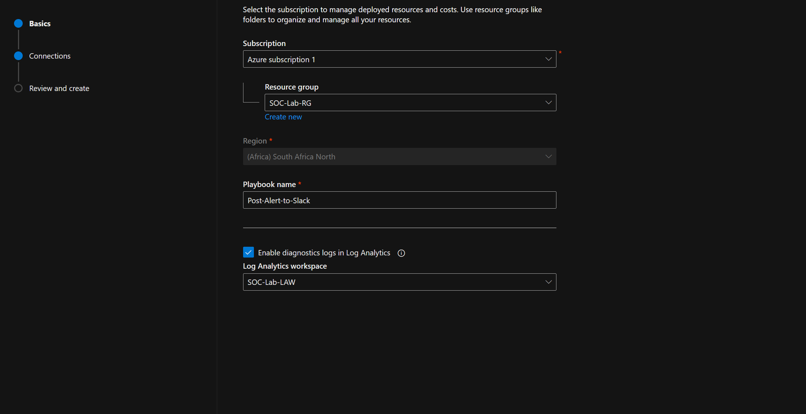

5. Once deployment is complete, click **Go to Playbook**. This opens the Logic App Designer.


### Step 3: Build the Logic App Workflow

1. In the Logic App Designer you will see the trigger block **Microsoft Sentinel incident**. Click the **+** under it to add a new step.

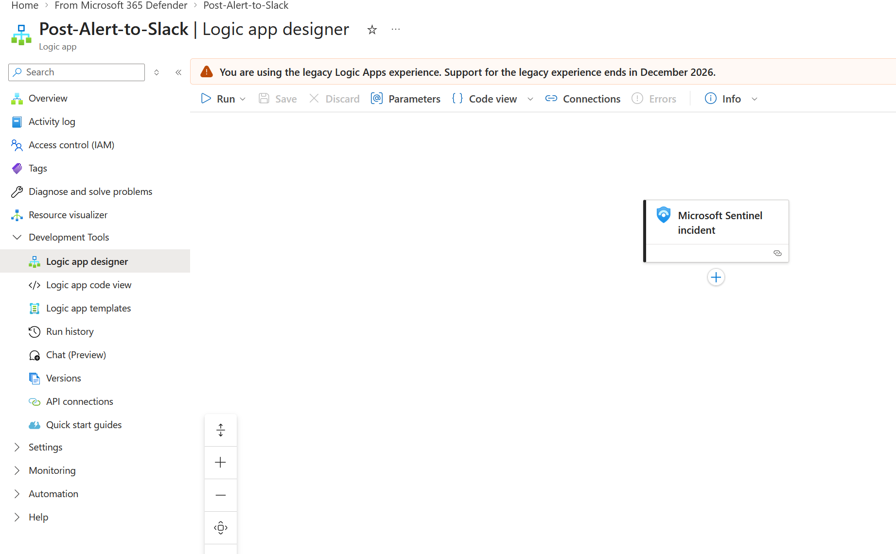

2. In the search box, type **Slack** and select the Slack connector.
3. Choose the action **Post message (V2)**.

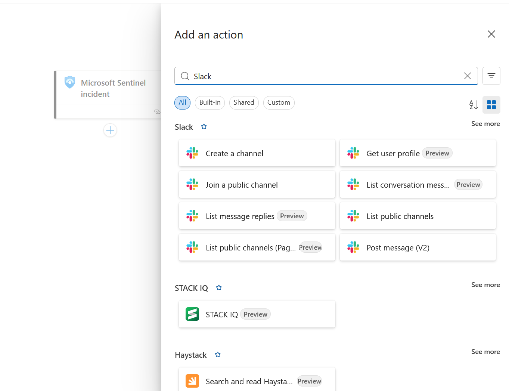

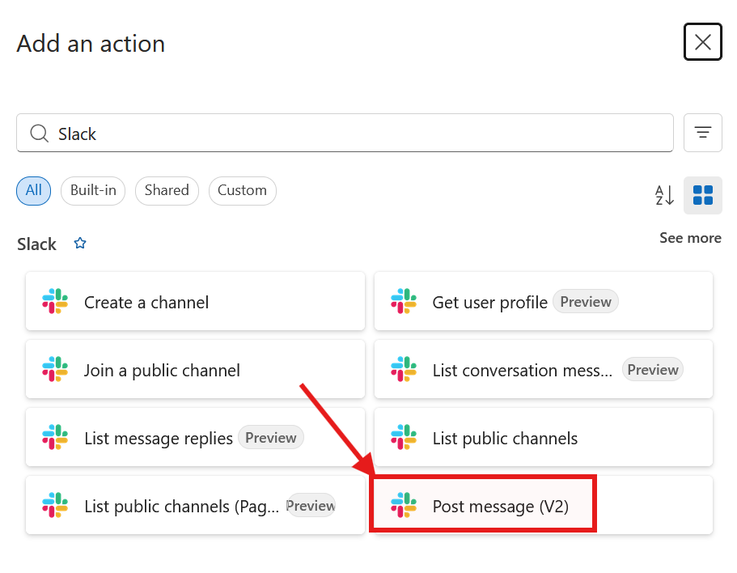

4. **Connection setup:**
    - Name the connection (e.g. `SlackSOC`).
    - Click **Sign in**. A pop-up will ask you to authorise Azure to access your Slack workspace. Allow it.

5. **Configure the message:**
    - **Channel Name:** Select your `#all-soc-lab` channel from the dropdown.
    - **Message Text:** Click inside the box and use the **Dynamic content** menu to build a message like this (Slack uses single `*` for bold):

```plaintext
‼️ **New Sentinel Alert Detected** ‼️
**Title**: [Incident Title]
**Severity**: [Incident Severity]
**Description**: [Incident Description]
**URL**: [Incident URL]
```

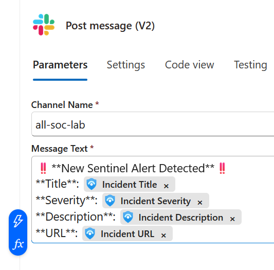

6. Click **Save**.

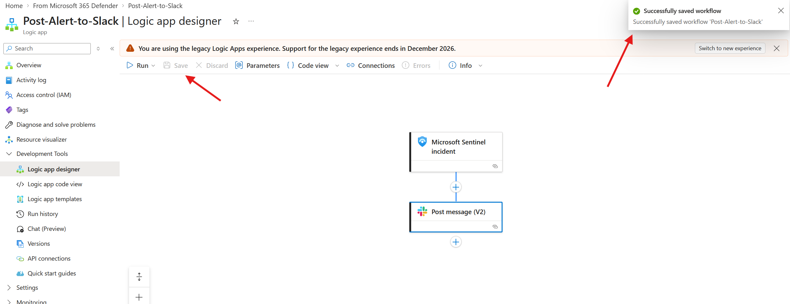


### Step 4: Link the Playbook to the Analytics Rule

For the playbook to run automatically, we must attach it to the brute-force rule we created in Phase 2.

1. Go back to the **Automation** page (in the Azure Portal or the Defender portal).
2. Click **+ Create** > **Automation rule**.

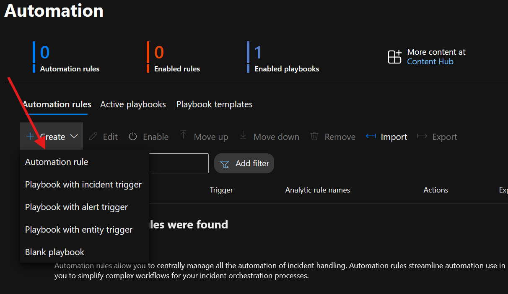

3. **Name:** `Trigger-Slack-Playbook`
4. **Trigger:** When incident is created.
5. **Conditions:** If **Analytic rule name** contains `[RDP Brute Force Detection] High Volume Failed Logins`.
6. **Actions:** Action type **Run playbook**, then select the `Post-Alert-to-Slack` playbook from the dropdown.

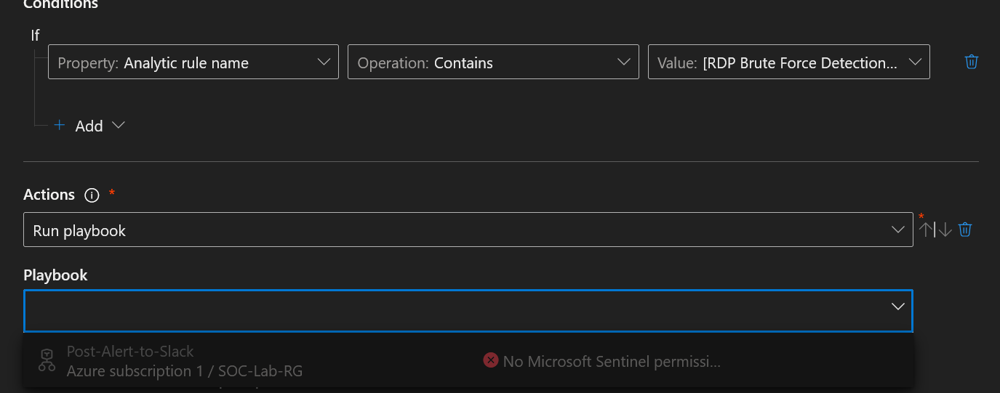

#### Troubleshooting: "No Microsoft Sentinel permissions"

At this point the playbook was greyed out with the error **No Microsoft Sentinel permissions**. Sentinel needs explicit permission to run playbooks in a resource group. To fix it:

1. In the Microsoft Sentinel left-hand menu, scroll to the bottom and click **Settings**.

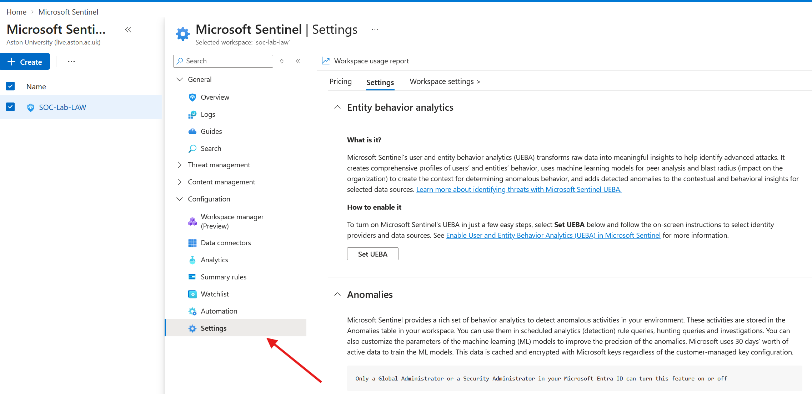

2. Select the **Settings** tab at the top of the main window.
3. Scroll down to **Playbook permissions** and click **Configure permissions**.

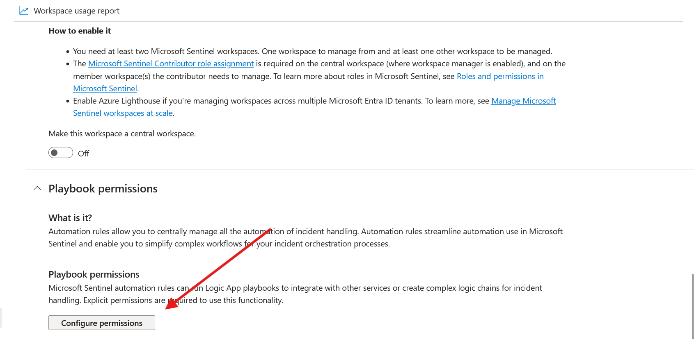

4. In the side pane, check your resource group (`SOC-Lab-RG`) and click **Apply**.

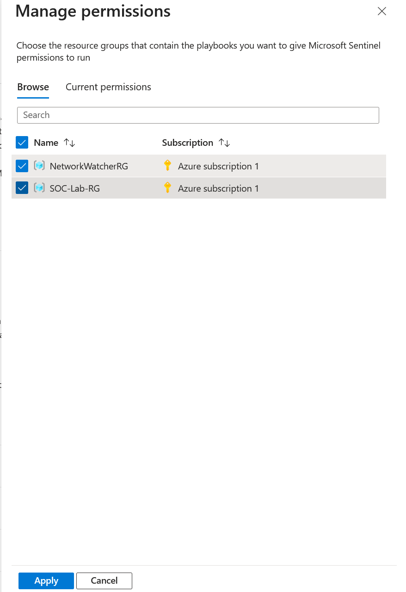

5. Return to the **Automation** menu and create the rule again. The `Post-Alert-to-Slack` playbook can now be selected.

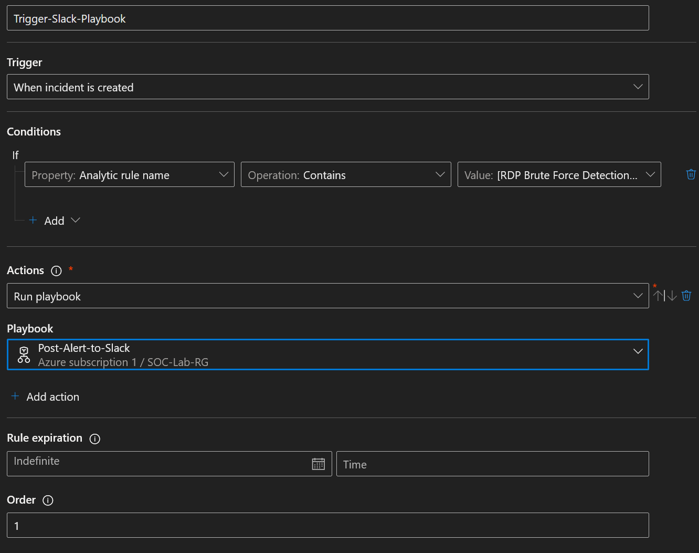

Click **Apply** to save the rule.

The SOAR automation is now live. The next time an IP fails 10 logins, Sentinel will create an incident and push the details to the Slack channel.

---

[← Previous: Log Analysis & KQL](02-log-analysis-kql.md) | [Back to README](../README.md) | [Next: Attack Simulation →](04-attack-simulation.md)
