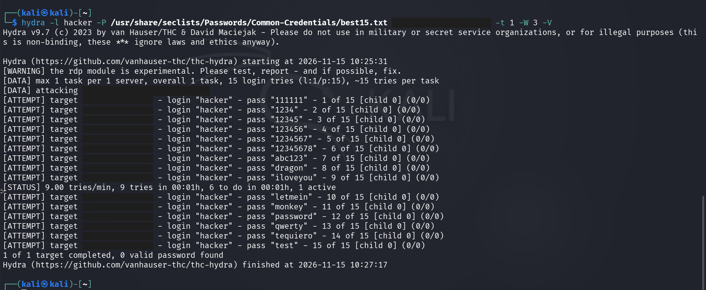
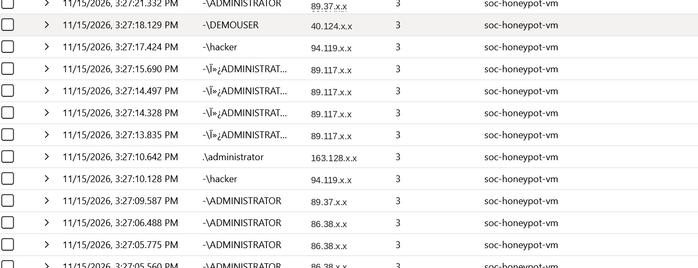
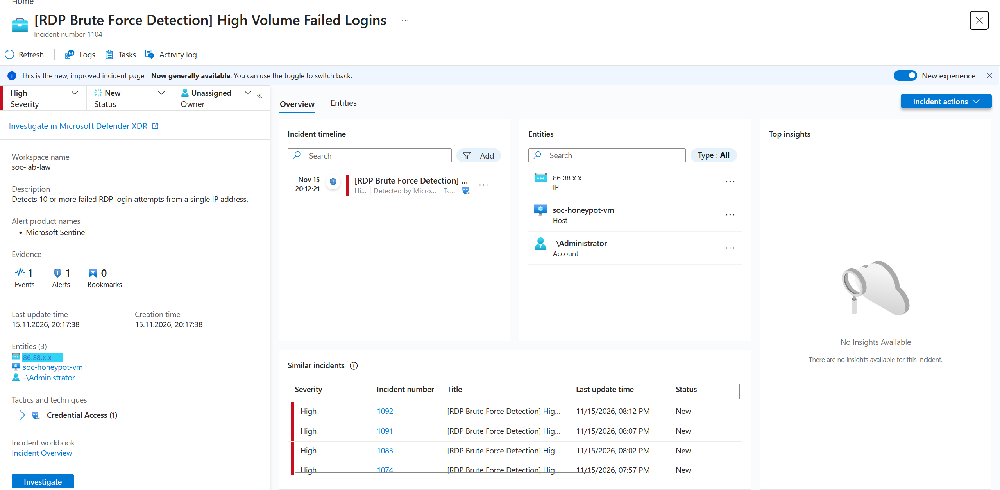
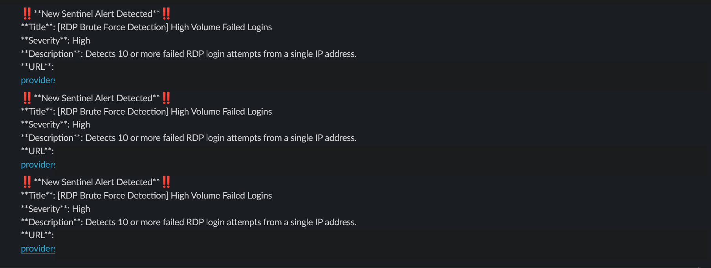
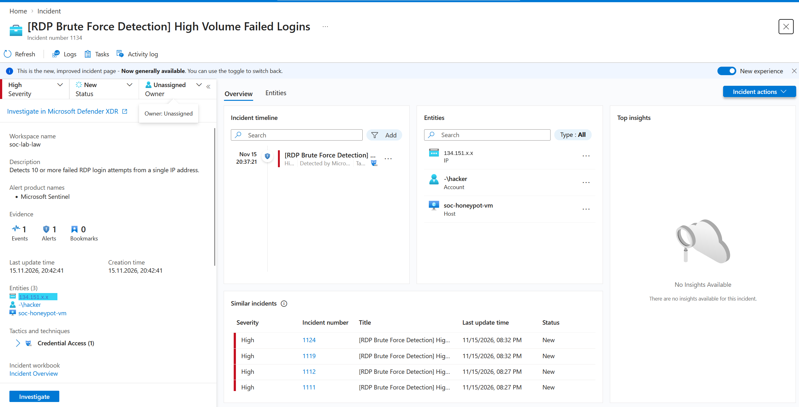

# Phase 4: Attack Simulation & Validation (Hydra)

[← Previous: SOAR Automation](03-soar-automation.md) | [Back to README](../README.md)

---

With the detection and SOAR pipeline live, the final step was to validate it. The honeypot was already receiving real brute-force traffic from internet scanners, so this phase had two goals: run a **controlled** brute-force test of my own, and confirm the pipeline raises incidents and pushes them to Slack.

### Step 1: Controlled Brute-Force with Hydra

From a Kali Linux machine, I used `Hydra` to throw a short list of common passwords at the honeypot's RDP service against a test user (`hacker`). The first attempt used the default parallelism and produced `freerdp: connection failed` errors, so I re-ran it with `-t 1 -W 3` (one task, a short wait between attempts), which the tool itself recommends for RDP.

```bash
hydra -l hacker -P /usr/share/seclists/Passwords/Common-Credentials/best15.txt rdp://<HONEYPOT_IP> -t 1 -W 3 -V
```



All 15 attempts completed and, as expected for a honeypot with no valid credentials, `0 valid password found`. I repeated the run several times while tuning the parallelism and the source address (see the finding below).

### Step 2: Confirm the Attack Reached the Telemetry

Filtering the `SecurityEvent` table for the test account confirmed that my Hydra attempts were ingested as Event ID 4625 / LogonType 3, alongside the constant stream of real-world scanners (`ADMINISTRATOR`, `DEMOUSER`, `administrator`, etc.):

```kql
SecurityEvent
| where EventID == 4625
| where Account == "hacker"
| project TimeGenerated, Account, IpAddress, LogonType, Computer
| sort by TimeGenerated desc
```



_(All source IPs are partially masked.)_

### Step 3: The Pipeline Fires on Real Traffic

The analytics rule generates incidents reliably from the **genuine internet scanners**, which hammer the honeypot from a single fixed IP and easily cross the "10+ failed logons from one IP" threshold. Below is a real incident, correctly enriched with the attacker IP, the host, and the targeted account entities (mapped in Phase 2):



The linked automation rule then ran the `Post-Alert-to-Slack` playbook, delivering the incident straight to the SOC channel:



### Finding: The Threshold Has a Source-IP Blind Spot

My **first** Hydra runs showed up in the logs but did **not** raise their own dedicated incident. The reason was visible in the Logs: the test account `hacker` appeared from **more than one source IP in the same `94.119.32.x` block** on consecutive attempts. My egress was rotating across an address pool, so the 15 attempts were split across several IPs. The rule aggregates with `summarize ... by IpAddress`, so no single IP reached the `>= 10` threshold, and the rule stayed quiet on my traffic while still firing on the single-source scanners.

This is a realistic detection-engineering limitation: a threshold keyed on a single source IP is **blind to low-and-slow and distributed / rotating-source** brute-forcing. It works well against noisy, single-source automated scanners, which is exactly what the honeypot attracts most of.

### Confirming the Fix: Pinning the Source IP

To validate that reading, I pinned my egress to a **single IP (`134.151.21.40`)** and re-ran Hydra. This time every attempt came from the one address and crossed the threshold, and the rule fired on **my own attack** — incident **#1134**, correctly mapped to the IP, the `-\hacker` account and the host, under Credential Access:



So the rule behaves exactly as designed: it reliably catches high-volume brute force from a **single source**, and the gap is specifically **rotating / distributed** sources.

**How I would tune it next to close that gap:**

- Also aggregate by **targeted account** (`by Account`), to catch password spraying where one account is hit from many IPs.
- Add a **total-volume-per-account** or **distinct-source-IP-count** condition.
- Enable Sentinel **UEBA** / anomaly rules for behavioural detection that doesn't rely on a fixed count.

---

[← Previous: SOAR Automation](03-soar-automation.md) | [Back to README](../README.md)
